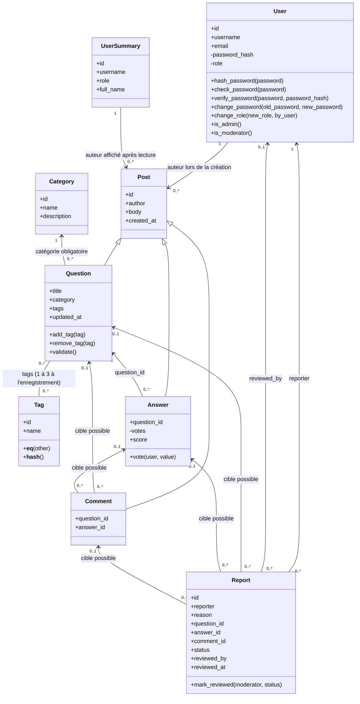
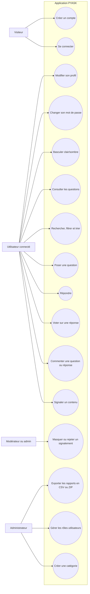

# Diagrammes PYASK

Ces diagrammes décrivent les classes du modèle et les fonctionnalités
actuellement accessibles dans l'interface PyQt5.

## Diagramme de classes

Chaque commentaire et chaque signalement vise exactement une cible parmi les
liens indiqués. Les votes sont conservés comme associations utilisateur/valeur
dans `Answer` et dans la table SQL `answer_votes`; il n'existe pas de classe
Python `Vote`.

## Diagramme de cas d'utilisation

Les catégories ne peuvent pas être supprimées lorsqu'elles sont utilisées par
des questions. Traiter un signalement masque sa cible sans la supprimer et
conserve la trace du modérateur, du motif et de la date. Les utilisateurs
ordinaires voient un remplacement; les modérateurs et admins peuvent consulter
le contenu original. Rejeter le signalement laisse le contenu visible.

Le profil permet de modifier le nom d'utilisateur, le nom complet et la bio.
Le changement de mot de passe exige le mot de passe actuel et la confirmation
du nouveau. Le thème clair/sombre est mémorisé localement par l'application.
